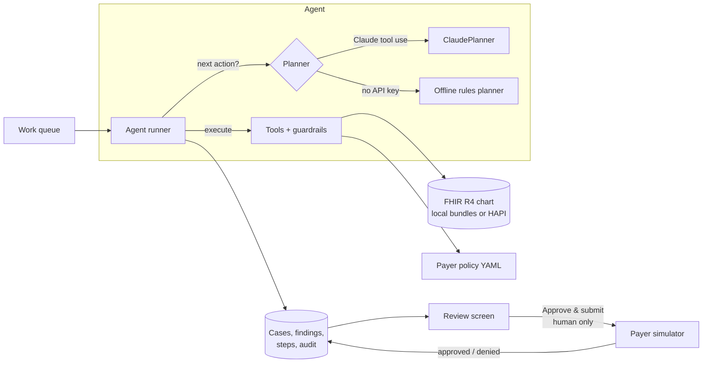

# ✚ AuthPilot

**A prior-authorization agent with a human in the loop.** AuthPilot reads a patient's FHIR chart, checks it against the payer's coverage policy, cites evidence for every criterion, and drafts the request, the question for the provider, or the appeal letter. A coordinator reviews the result and clicks **Approve & submit**. The agent has no ability to submit anything itself.

> ⚠️ **Synthetic data only.** Every patient is generated by `scripts/generate_patients.py`. *Northwind Health Plan* and its policies are fictional and simplified; they are not clinical guidance.

     

## Why this problem
Clinics spend hours a day on prior authorization: finding evidence in the chart, matching it to each payer's rules, filling in forms, and chasing denials. The work is repetitive and document-heavy, and every claim needs to be justified. That makes it a good fit for an agent, provided the agent stays grounded in the chart and a human stays accountable for what is submitted.

## The demo story
| Case | Patient | What happens |
|---|---|---|
| **1. Ready** | James Walker, lumbar MRI | The agent finds 8 weeks of symptoms, 6 PT sessions and an NSAID trial, and cites each record. Maria (the coordinator) reviews, edits the draft and approves. The payer approves. |
| **2. Needs info** | Linda Park, semaglutide | HbA1c 8.1% ✓, but **no metformin trial documented**. The agent doesn't submit a weak request; it asks Dr. Chen a specific question. Once the provider documents a metformin intolerance, the agent re-checks and the case becomes ready. |
| **3. Denial → appeal** | Robert Diaz, knee MRI | A manual submission was denied: *"conservative therapy not documented"*. The agent re-reads the chart, finds the PT discharge summary in **scanned outside records**, and drafts an appeal letter citing it. The appeal is approved. |

## Architecture



### Agent tools
| Tool | Purpose | Guardrail |
|---|---|---|
| `get_case`, `get_policy` | Case context and the payer's human-readable criteria | The agent sees the policy text, not the payer's internal rules |
| `search_records`, `read_record` | Search and read the FHIR chart, including note and scanned-document text | Read-only |
| `record_finding` | Verdict per criterion with `{resource_id, quote}` citations | **Rejects records that aren't in this patient's chart, and quotes not found verbatim in the cited record** |
| `finish` | `ready` / `needs_info` / `not_supported` plus summary or provider question | **Rejects inconsistent outcomes** (e.g. "ready" with an unmet criterion, or missing findings) |
| *(none)* | Submitting to the payer | **There is no submit tool.** Only the coordinator's Approve button submits. |

Rejected tool calls go back to the model as `is_error` results, so it corrects itself. The review screen shows these as "rejected by guardrail" in the activity log.

### Claude integration
- Manual tool-use loop (`authpilot/agent/planners.py`) with **strict tool schemas**, **adaptive thinking with summarized display** (the reasoning summaries stream into the UI timeline), explicit effort, prompt caching, and server-side refusal fallbacks.
- The conversation history is append-only. Parallel tool calls are answered in a single message, and refusals and truncation mark the case for a human to handle.
- A step limit stops runaway loops. Every step is persisted (`agent_steps`) and every action is audited (`audit_events`).

## Evaluation
`authpilot eval` runs a planner over **30 labelled synthetic cases**. Labels are set when the cases are generated. **6 are deliberate traps** that literal rules get wrong:

| Trap | Why it's hard |
|---|---|
| PT "recommended… has not started yet" | A keyword match on "physical therapy" ≠ therapy received |
| NSAID order with status `cancelled` | The order exists but was never taken |
| "Discussed starting metformin; prefers diet first" | The drug is mentioned but was never trialed |
| "Patient declined physical therapy referral" | Negation |
| HbA1c recorded only in the visit note | No structured Observation |
| PT coded as a local "physiotherapy" procedure | Synonym, non-standard code |

| Planner | Overall | Traps | Other cases |
|---|---|---|---|
| Offline rules (baseline) | **24/30 (80%)** | 0/6 | 24/24 |
| Claude (`authpilot eval --planner claude`) | *run with your API key* | | |

The baseline is deterministic and checked in CI. The traps are where reading the chart in context, as Claude does, should make the difference. Run it yourself and the report appears on the **Evaluation** page.

## Quick start
```bash
python -m venv .venv && source .venv/bin/activate      # Windows: .venv\Scripts\activate
pip install -e ".[dev]"
cp .env.example .env            # optional: ANTHROPIC_API_KEY to use Claude
authpilot serve                 # http://127.0.0.1:8000  (API docs at /docs)
authpilot eval                  # offline baseline; add --planner claude to use Claude
pytest                          # 34 tests
```
Without an API key, everything runs with the offline planner, and the top bar shows which planner is active.

**Docker:** `docker compose up --build` starts the app and PostgreSQL. Add `--profile fhir` to also start a **HAPI FHIR** server, load it with `python scripts/load_fhir_server.py http://localhost:8080/fhir`, and set `FHIR_BASE_URL=http://fhir:8080/fhir` so the agent reads the chart over the real FHIR REST API.

### Deploy to Vercel
The app runs as a single Vercel Function (`[tool.vercel] entrypoint = "authpilot.main:app"` in `pyproject.toml`). When `VERCEL=1` is set it adapts:

| | Local / Docker | Vercel |
|---|---|---|
| Agent runs | Background task; the UI polls the timeline | Run within the request (work can't outlive a response) |
| Database | SQLite in `var/` or Compose Postgres | **`DATABASE_URL` (Neon Postgres)**, falling back to per-instance `/tmp` SQLite with a "data may reset" banner |
| Provider replies added to the chart | Database table `chart_additions` | Same, so every instance sees them |
| Abuse protection | none | `MAX_AGENT_RUNS_PER_HOUR` → `429` |

1. Import the repo at **vercel.com/new** (no build settings needed).
2. Optional but recommended: **Storage → Create → Neon**. This adds `DATABASE_URL`; `postgres://` URLs are normalised for psycopg.
3. Environment variables: `MAX_AGENT_RUNS_PER_HOUR=30`, and optionally `ANTHROPIC_API_KEY` to use Claude instead of the offline planner.

## API
| Method | Path | |
|---|---|---|
| `GET` | `/api/cases`, `/api/cases/{id}` | Queue, and case detail with findings, agent steps and available actions |
| `POST` | `/api/cases/{id}/run` | Start the agent (background) |
| `POST` | `/api/cases/{id}/approve` | **Human gate**: submit the (optionally edited) draft and cited evidence to the payer |
| `POST` | `/api/cases/{id}/check-status` | Poll the payer for a decision |
| `POST` | `/api/cases/{id}/appeal` | The agent re-reviews a denied case and drafts an appeal |
| `POST` | `/api/cases/{id}/provider-reply` | Demo: the provider documents the missing information and the agent re-runs |
| `POST` | `/api/cases/{id}/withdraw` | Close without submitting |
| `GET` | `/api/patients/{pid}/records/{rid}` | Evidence viewer (rendered text + FHIR JSON) |
| `GET` | `/api/audit`, `/api/eval` | Audit trail, evaluation reports |

Actions are allowed only in valid states (`409` otherwise). For example, you can't approve a case the agent hasn't finished reviewing, or one it recommends not submitting.

## Compliance notes
A real deployment would need a signed Business Associate Agreement (BAA) with the AI vendor (HIPAA), encryption at rest and in transit, role-based access, retention of the audit trail, and organizational sign-off on the human-review policy. The design already keeps the agent read-only toward the chart, logs every data access through tools, and leaves submission to people.

## Project layout
```
authpilot/
  agent/tools.py       tool schemas + grounding/consistency guardrails
  agent/planners.py    ClaudePlanner (tool-use loop) and offline rules planner
  agent/runner.py      drives a planner, persists every step, audits the run
  fhir.py              local bundle store, HTTP FHIR client, resource rendering
  rules.py             deterministic criteria engine (payer adjudication + baseline)
  payer.py             Northwind payer simulator (adjudicates cited evidence only)
  policies/            Northwind coverage policies (YAML)
  api.py               FastAPI app, case workflow and human gate
  evaluation.py        eval harness and reports
  templates/ static/   queue, case review, audit and eval pages
scripts/               synthetic data generator, FHIR server loader
data/                  generated FHIR bundles, case specs, provider replies
tests/                 34 tests (flows, guardrails, Claude loop with fake client, payer, FHIR HTTP, serverless)
```
